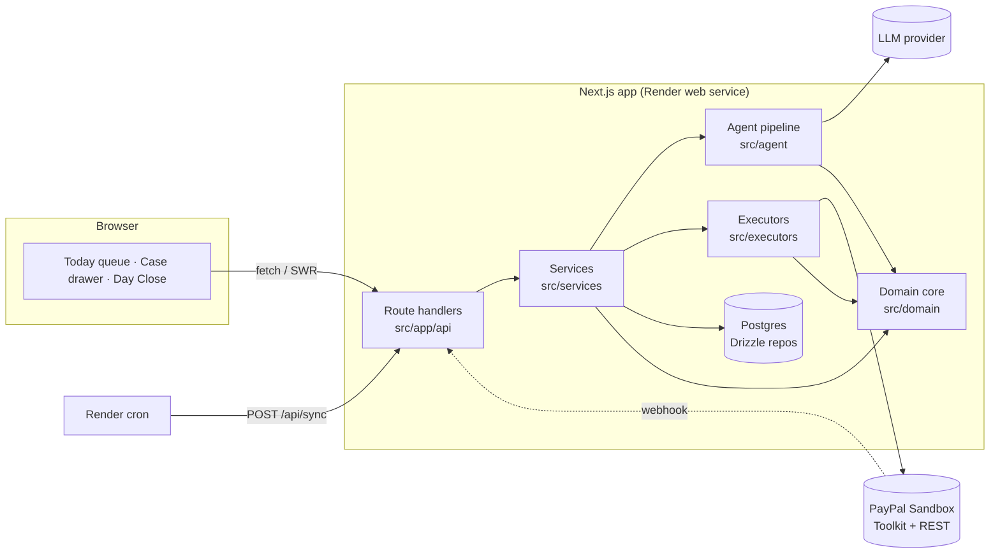
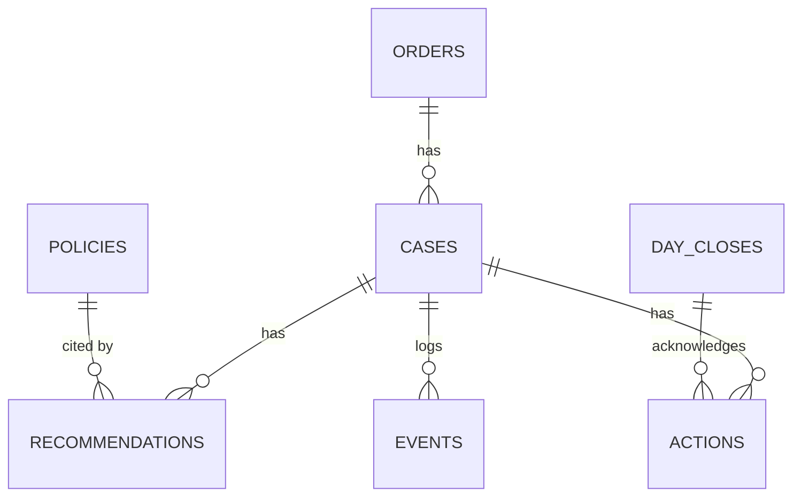
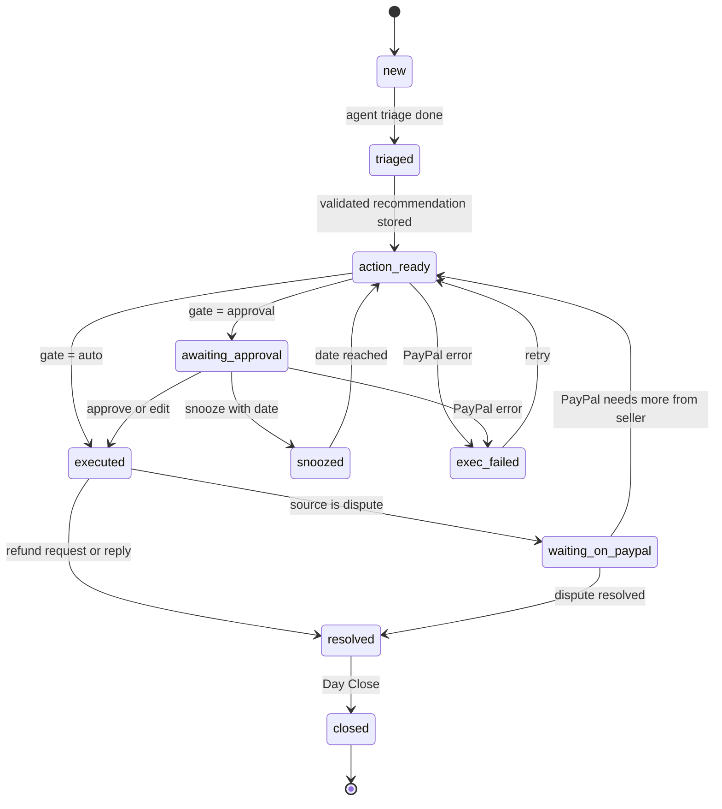
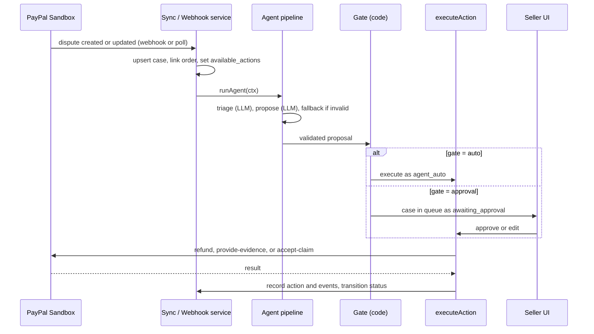

# Resolution Desk: Architecture and System Design

> Audience: engineers and coding agents. This file is the source of truth for structure and contracts. Keep it accurate: update rules are in [AGENTS.md §5](AGENTS.md).

## Contents

1. [Purpose and principles](#1-purpose-and-principles)
2. [System overview](#2-system-overview)
3. [File structure](#3-file-structure)
4. [Module catalog (reuse index)](#4-module-catalog-reuse-index)
5. [Component structure (UI)](#5-component-structure-ui)
6. [Data model](#6-data-model)
7. [State machine](#7-state-machine)
8. [Core flows](#8-core-flows)
9. [Business rules](#9-business-rules)
10. [API contracts](#10-api-contracts)
11. [PayPal integration](#11-paypal-integration)
12. [LLM integration](#12-llm-integration)
13. [Reliability and failure modes](#13-reliability-and-failure-modes)
14. [Security and privacy](#14-security-and-privacy)
15. [Testing architecture](#15-testing-architecture)
16. [Deployment and configuration](#16-deployment-and-configuration)
17. [Extension points](#17-extension-points)
18. [Decision log](#18-decision-log)

---

## 1. Purpose and principles

Resolution Desk turns PayPal refund requests and disputes into one daily queue. An agent proposes an action per case; code validates it and decides whether it may run automatically; the seller approves, edits, or snoozes; executors call PayPal.

Principles (every design choice below follows from these):

1. **LLM proposes, code disposes.** The LLM never executes, never changes state, never chooses auto vs approval.
2. **One way to do each thing.** One status-change function, one execute function, one PayPal HTTP wrapper, one structured-LLM wrapper.
3. **Pure core, impure edges.** `domain/` does no I/O. Everything with I/O sits behind a port or a repo.
4. **Everything is an event.** An append-only `events` table feeds the timeline and the audit trail.
5. **Idempotent by construction.** Repeating a click, a webhook, or a retry cannot move money twice.
6. **Thin routes, orchestrating services, dumb UI.** Business logic lives in `domain/` and `services/`.
7. **Simulation is explicit.** Anything not run live is flagged `simulated` and labelled in the UI.
8. **Minimal surface.** Every screen and action sits on the daily loop. If it is not on the loop, it is not built.

## 2. System overview



### Layers and dependency rules

Enforced by ESLint `no-restricted-imports` (configured in task F1). Violations fail `pnpm check`.

| Layer | Path | May import | Must not import |
|---|---|---|---|
| Domain | `src/domain` | `zod`, pure `lib` helpers (`money`, `hash`) | everything else |
| Lib | `src/lib` | nothing app-specific | any layer |
| DB | `src/db` | `domain`, `lib` | services, agent, executors, integrations, ui |
| Integrations | `src/integrations` | `domain` (types), `lib` | db, services, agent, executors, ui |
| Agent | `src/agent` | `domain`, `lib`, `integrations/llm` port | db, PayPal |
| Executors | `src/executors` | `domain`, `lib`, `integrations/paypal` port | db, agent, ui |
| Services | `src/services` | all server layers | ui |
| Routes | `src/app/api` | `services`, `lib/route` | db, integrations directly |
| UI | `src/ui`, `src/app/**/page.tsx` | `domain` types, `lib/api`, `lib/money` | any server layer |

The agent and executors receive data as arguments and return results. Only services touch the database.

## 3. File structure

```
resolution-desk/
├─ README.md                  product overview, quick start (judge-facing)
├─ ARCHITECTURE.md            this file
├─ AGENTS.md                  rules for coding agents
├─ PROGRESS.md                task board, blockers, changelog
├─ SPIKE.md                   dispute spike results (A–H)
├─ .env.example               every env var, no secrets
├─ docker-compose.yml         local Postgres
├─ render.yaml                Render blueprint: web + Postgres + cron
├─ package.json  tsconfig.json  next.config.ts  vitest.config.ts  drizzle.config.ts
├─ drizzle/                   generated SQL migrations (commit them, never hand-edit)
├─ scripts/
│  ├─ spike/                  one script per spike step: a-token.ts … h-refund.ts
│  ├─ seed.ts                 policy, orders, refund requests (fake or sandbox ids)
│  ├─ sandbox-orders.json     generated by `pnpm spike:orders` (git-ignored)
│  └─ demo-reset.ts           reset data and simulated clock
├─ src/
│  ├─ app/                    Next.js App Router: pages and route handlers only
│  │  ├─ layout.tsx
│  │  ├─ page.tsx                          Today queue
│  │  ├─ cases/[id]/page.tsx               case view (deep link, same CaseDrawer)
│  │  ├─ close/page.tsx                    Day Close
│  │  └─ api/
│  │     ├─ cases/route.ts                 GET list
│  │     ├─ cases/[id]/route.ts            GET detail
│  │     ├─ cases/[id]/decision/route.ts   POST approve | edit | snooze
│  │     ├─ sync/route.ts                  POST pull from PayPal (UI and cron)
│  │     ├─ webhooks/paypal/route.ts       POST PayPal webhooks
│  │     ├─ day/close/route.ts             GET status, POST close
│  │     ├─ demo/advance-day/route.ts      POST (DEMO_MODE only)
│  │     ├─ demo/reset/route.ts            POST (DEMO_MODE only)
│  │     └─ health/route.ts                GET
│  ├─ services/               use-cases: orchestrate db + agent + executors + paypal
│  │  ├─ syncCases.ts         pull disputes, upsert cases, link orders, trigger processing
│  │  ├─ processCase.ts       load context → runAgent → validate → gate → persist → maybe auto-execute
│  │  ├─ decideCase.ts        approve | edit | snooze
│  │  ├─ executeAction.ts     the only path that runs an executor (idempotency, transitions, events)
│  │  ├─ handleWebhook.ts     verify, dedupe, apply PayPal events to cases
│  │  ├─ wakeSnoozed.ts       snoozed → action_ready when the date arrives
│  │  ├─ closeDay.ts          Day Close checks and ledger
│  │  ├─ getCases.ts          read models: CaseListItem, CaseDetail
│  │  └─ demoControls.ts      advance day, reset
│  ├─ agent/                  LLM work; no db, no PayPal
│  │  ├─ pipeline.ts          runAgent(ctx): triage → propose → fallback
│  │  ├─ triage.ts            classify reason, extract claim
│  │  ├─ propose.ts           propose action, clause, rationale, narrative, drafts
│  │  ├─ fallback.ts          deterministicProposal(ctx), used when the LLM fails or breaks a rule
│  │  ├─ evidencePackage.ts   build evidence payload from order record + narrative
│  │  └─ prompts/             triage.ts, propose.ts (prompt text only)
│  ├─ domain/                 pure rules, zero I/O
│  │  ├─ types.ts             zod schemas + inferred types (single source of truth)
│  │  ├─ states.ts            CaseStatus, TRANSITIONS, canTransition(), ACTIONABLE
│  │  ├─ policy.ts            PolicyRules, matchClause()
│  │  ├─ evidence.ts          requiredEvidence(reason), evidenceCompleteness()
│  │  ├─ validate.ts          validateRecommendation()
│  │  ├─ gate.ts              autonomyGate()
│  │  ├─ provenance.ts        buildProvenance()
│  │  └─ queue.ts             bucket and sort rules
│  ├─ executors/              one PayPal-facing action each; pure over PayPalPort
│  │  ├─ types.ts             ActionExecutor interface
│  │  ├─ registry.ts          type → executor
│  │  ├─ refund.ts  contest.ts  acceptClaim.ts  reply.ts
│  ├─ integrations/
│  │  ├─ paypal/
│  │  │  ├─ port.ts           PayPalPort interface (the mocking seam)
│  │  │  ├─ http.ts           PayPalHttp: token cache, retries, request-id, error mapping
│  │  │  ├─ toolkit.ts        @paypal/agent-toolkit adapter
│  │  │  ├─ disputes.ts       Disputes REST: provideEvidence, settleSandbox
│  │  │  ├─ real.ts           RealPayPal = toolkit + disputes behind PayPalPort
│  │  │  ├─ fake.ts           FakePayPal: in-memory, flags results simulated
│  │  │  ├─ mappers.ts        PayPal JSON → domain types (amounts, links, dates)
│  │  │  ├─ webhooks.ts       signature verification, event parsing
│  │  │  └─ index.ts          createPayPal() chooses real or fake from env
│  │  └─ llm/
│  │     ├─ port.ts           LlmPort interface
│  │     ├─ structured.ts     generateStructured(): schema-validated, one retry
│  │     ├─ providers/        anthropic.ts, mock.ts
│  │     └─ index.ts          createLlm()
│  ├─ db/
│  │  ├─ schema.ts            Drizzle tables
│  │  ├─ client.ts            connection, transaction helper
│  │  └─ repos/               cases, events, actions, orders, policies, recommendations,
│  │                          dayCloses, webhookDeliveries, appState
│  ├─ ui/
│  │  ├─ primitives/          Button, Badge, Card, Dialog (minimal, Tailwind)
│  │  ├─ components/          see §5
│  │  └─ hooks/               useCases, useCase, useDecision, useDayClose
│  └─ lib/
│     ├─ env.ts  errors.ts  logger.ts  money.ts  clock.ts  hash.ts
│     ├─ route.ts             handler(): zod input, service call, error → HTTP
│     ├─ api.ts               typed client fetch used by hooks
│     └─ pdf.ts               renderDeliveryReceipt() via pdf-lib
└─ tests/
   ├─ unit/                   domain, agent, lib (mirrors src)
   ├─ integration/            executors, services, api (PGlite + MSW)
   ├─ sandbox/                opt-in live PayPal tests
   ├─ e2e/demo.test.ts        whole demo flow at service level
   ├─ fixtures/paypal/        real sandbox responses saved from the spike
   └─ helpers/                db.ts, factories.ts, paypalMsw.ts, mockLlm.ts
```

## 4. Module catalog (reuse index)

Before writing new code, find the need here. If it exists, use it. If you add or change a module, update this table in the same task.

| Need | Use | Path |
|---|---|---|
| Change a case's status | `casesRepo.transition(id, from[], to, actor, payload)`: guarded, optimistic, writes an event | `db/repos/cases.ts` + `domain/states.ts` |
| Record an event | `eventsRepo.append()` | `db/repos/events.ts` |
| Run a PayPal-affecting action | `executeAction({caseId, type, input, actor})` | `services/executeAction.ts` |
| Call PayPal | `createPayPal()` returns a `PayPalPort`; raw HTTP only inside `http.ts` | `integrations/paypal/` |
| Call the LLM for structured output | `generateStructured({schema, system, input})` | `integrations/llm/structured.ts` |
| Decide auto vs approval | `autonomyGate(rec, ctx)` | `domain/gate.ts` |
| Check a proposal | `validateRecommendation(proposal, ctx)` | `domain/validate.ts` |
| Score evidence | `evidenceCompleteness(order, reason)` | `domain/evidence.ts` |
| Build the provenance object | `buildProvenance(ctx, rec, gate)` | `domain/provenance.ts` |
| Fallback proposal | `deterministicProposal(ctx)` | `agent/fallback.ts` |
| Money conversion | `toCents`, `fromCents`, `formatMoney` | `lib/money.ts` |
| Current time (simulated clock aware) | `clock.now()` | `lib/clock.ts` |
| Read env | `env` (parsed once) | `lib/env.ts` |
| Throw / map errors | `AppError(code, message, details)` | `lib/errors.ts` |
| Write an API route | `handler({input, run})` | `lib/route.ts` |
| Call API from UI | `api.get/post` | `lib/api.ts` |
| Idempotency key | `idempotencyKey(parts)` | `lib/hash.ts` |
| Delivery receipt PDF | `renderDeliveryReceipt(order)` | `lib/pdf.ts` |
| Render provenance | `<ProvenancePanel provenance={…}/>` | `ui/components/ProvenancePanel.tsx` |
| Test DB / factories / mocks | `createTestDb()`, `factories`, `paypalMsw`, `MockLlm` | `tests/helpers/` |

## 5. Component structure (UI)

```
app/page.tsx  (Today)
 ├─ SyncBar              last sync, "Sync now", PayPal mode badge (SIMULATED when fake)
 ├─ QueueGrid            AG Grid; row click opens the drawer
 └─ CaseDrawer           selected case; also rendered by /cases/[id]
     ├─ CaseHeader       id, reason, DeadlineChip, StatusBadge
     ├─ BuyerMessage     untrusted text, rendered as plain text
     ├─ RecommendationCard   action, amount, rationale, ModeBadge
     ├─ ProvenancePanel  policy clause, order, tracking, evidence, PayPal action, mode
     │   └─ EvidenceChecklist
     ├─ ActionBar        Approve / Edit / Snooze, with disabled reasons
     │   ├─ EditDialog       refund amount or narrative text
     │   └─ SnoozeDialog     date required
     └─ EventTimeline

app/close/page.tsx  (Day Close)
 ├─ DayCloseGate         blockers and unacknowledged actions; Close button
 ├─ DayCloseGrid         AG Grid of today's actions
 └─ AckList              automatic actions to acknowledge

shared: StatusBadge  ModeBadge  Money  DeadlineChip  SimulatedLabel  ErrorBanner
```

| Component | Props | Data source | Notes |
|---|---|---|---|
| `QueueGrid` | `items: CaseListItem[]`, `onSelect(id)` | `useCases()` | Columns: deadline, case, reason, amount at risk, status, recommended action, mode |
| `CaseDrawer` | `caseId` | `useCase(id)` | Owns the decision mutation via `useDecision` |
| `ProvenancePanel` | `provenance: Provenance` | server-built | Pure; reused by drawer and case page |
| `ActionBar` | `detail: CaseDetail`, `onDecide(d)` | `useDecision` | Buttons enabled from `detail.availableDecisions` |
| `DayCloseGate` | `status: DayCloseStatus`, `onClose(ids)` | `useDayClose()` | Close disabled until `canClose` |

UI rules: no business logic in components. Anything derived (available decisions, mode, completeness, bucket) is computed on the server and sent as fields. Pages stay thin.

## 6. Data model



| Table | Columns (key ones) |
|---|---|
| `cases` | `id` uuid pk · `source` (`dispute`/`refund_request`) · `paypal_dispute_id` unique null · `order_id` fk · `reason` · `buyer_message` · `amount_cents` · `currency` (`USD`) · `deadline_at` null · `status` · `snoozed_until` date null · `outcome` null (`seller_favor`/`buyer_favor`/`refunded`/`conceded`/`replied`) · `available_actions` jsonb (from PayPal links) · `simulated` bool · `version` int · `created_at` · `updated_at` |
| `orders` | `id` pk · `item` · `amount_cents` · `currency` · `paypal_order_id` · `paypal_capture_id` · `paypal_transaction_id` · `refunded_cents` · `carrier` · `tracking_number` · `tracking_status` (`none`/`in_transit`/`delivered`/`exception`) · `shipped_at` · `delivered_at` |
| `policies` | `id` · `version` · `text` · `rules` jsonb · `active` |
| `recommendations` | `id` · `case_id` · `action` · `refund_amount_cents` null · `policy_clause_id` · `rationale` · `evidence_narrative` null · `tracking_message_draft` null · `provenance` jsonb · `mode` (`auto`/`approval`) · `gate_reasons` jsonb · `origin` (`llm`/`fallback`) · `validation` jsonb · `created_at` (latest row per case is current) |
| `actions` | `id` · `case_id` · `recommendation_id` · `type` · `input` jsonb · `idempotency_key` **unique** · `status` (`pending`/`succeeded`/`failed`) · `actor` (`agent_auto`/`seller`) · `request` jsonb · `response` jsonb · `error` jsonb · `paypal_refs` jsonb · `simulated` bool · `acknowledged_at` null · `created_at` |
| `events` | `id` bigserial · `case_id` · `type` · `actor` (`system`/`agent`/`seller`/`paypal`) · `payload` jsonb · `at` |
| `day_closes` | `id` · `day` date unique · `summary` jsonb · `closed_at` |
| `webhook_deliveries` | `event_id` pk · `event_type` · `verified` bool · `payload` jsonb · `received_at` · `processed_at` null |
| `app_state` | `key` pk · `value` jsonb (`clock_offset_days`, `last_sync_at`) |

Event types: `case.created`, `agent.triaged`, `agent.recommended`, `gate.decided`, `seller.approved`, `seller.edited`, `seller.snoozed`, `action.started`, `action.succeeded`, `action.failed`, `paypal.dispute_updated`, `paypal.dispute_resolved`, `case.transitioned`, `day.closed`.

## 7. State machine



| From | To | Trigger | Actor |
|---|---|---|---|
| `new` | `triaged` | triage stored | system |
| `triaged` | `action_ready` | validated recommendation stored | agent |
| `action_ready` | `executed` | gate = auto, PayPal call succeeded | agent_auto |
| `action_ready` | `awaiting_approval` | gate = approval | system |
| `awaiting_approval` | `executed` | seller approves or edits, PayPal call succeeded | seller |
| `awaiting_approval` | `snoozed` | seller snoozes with a date | seller |
| `snoozed` | `action_ready` | date reached (`wakeSnoozed`) | system |
| `action_ready`, `awaiting_approval` | `exec_failed` | PayPal error | system |
| `exec_failed` | `action_ready` | retry from sync or seller | system / seller |
| `executed` | `waiting_on_paypal` | source is `dispute` | system |
| `executed` | `resolved` | source is `refund_request`, or action is `reply` | system |
| `waiting_on_paypal` | `resolved` | dispute resolved (webhook or poll) | paypal |
| `waiting_on_paypal` | `action_ready` | PayPal asks the seller for more | paypal |
| `resolved` | `closed` | Day Close | seller |

Any other transition throws `CONFLICT_STATE`. `executed` is only written after the PayPal call succeeded; an executed dispute is **not** resolved until PayPal says so.

**Actionable** (blocks Day Close): `new`, `triaged`, `action_ready`, `awaiting_approval`, `exec_failed`, and `snoozed` with `snoozed_until <= today`. `waiting_on_paypal` and future-snoozed cases do not block.

## 8. Core flows

### A. Intake to execution



`processCase(caseId)` steps: load case + order + policy + available actions → `runAgent(ctx)` → `validateRecommendation` → `autonomyGate` → `buildProvenance` → persist recommendation → transition (`new→triaged→action_ready`) → if `auto`, `executeAction(actor='agent_auto')`, else transition to `awaiting_approval`.

### B. Decision (approve / edit / snooze)

`decideCase(caseId, decision)`: load case → check status is `awaiting_approval` (or `exec_failed`) → `approve`: `executeAction` with the recommended input · `edit`: validate edits (amount ≤ order amount minus refunded; narrative text only), re-run `validateRecommendation` and `buildProvenance`, then `executeAction` with the edited input · `snooze`: require a future date, set `snoozed_until`, transition to `snoozed`. Stale state returns `CONFLICT_STATE`.

### C. Webhook

`handleWebhook(rawBody, headers)`: verify signature (`PayPalPort.verifyWebhook`) → insert into `webhook_deliveries` (unique `event_id`; duplicate → return 200, do nothing) → map event to a dispute ID → re-fetch the dispute (`getDispute`) rather than trusting the payload → update `available_actions`, `deadline_at`, and status transitions (`waiting_on_paypal → resolved` or `→ action_ready`) → mark `processed_at`. Return 200 once stored. Polling (`syncCases`) runs the same re-fetch path, so a missed webhook heals on the next sync.

### D. Day Close

`closeDay(ackIds)`: compute `blockers` (actionable cases) and `unacknowledged` (actions with `actor='agent_auto'` and `acknowledged_at IS NULL`). If either is non-empty, or `ackIds` does not cover all unacknowledged, return `DAY_CLOSE_BLOCKED` with both lists. Otherwise, in one transaction: set `acknowledged_at`, transition every `resolved` case to `closed`, insert `day_closes` with the summary.

Summary fields: `refundedCents`, `autoActions`, `approvedActions`, `contested`, `disputesWon` (sandbox), `conceded`, `snoozedCarriedOver`. We never report a win probability.

## 9. Business rules

### 9.1 Policy shape (`domain/policy.ts`)

```ts
PolicyRules {
  version: number
  clauses: { id: string; text: string }[]   // e.g. { id: "P-1", text: "Refund automatically up to $25 when tracking shows the parcel never arrived." }
  autoRefundCapCents: number
  autoRefundReasons: Reason[]
  refundWindowDays: number
}
```

The seller-facing policy is plain English clauses with stable IDs. The LLM may only cite an ID that exists. `scripts/seed.ts` contains the example policy used in the demo.

### 9.2 Supported reasons

| Reason | Contest | Refund | Accept claim |
|---|---|---|---|
| Item not received (`MERCHANDISE_OR_SERVICE_NOT_RECEIVED`, confirm spelling in spike) | yes | yes | yes |
| Any other dispute reason | no (v1) | yes | yes |
| Refund request (not a dispute) | n/a | yes | n/a |

`reply` is available for refund requests, and for any case with no other valid action.

### 9.3 Evidence completeness (`domain/evidence.ts`)

Required items to contest "item not received": `orderId`, `carrier`, `trackingNumber`, `deliveryStatus = delivered`, `deliveredAt`, `deliveryReceiptPdf` (generated from the order record). Completeness is `present/required` plus the list of missing items. A contest is valid only at 100%. Completeness is a checklist, not a probability.

### 9.4 Validation (`domain/validate.ts`)

A proposal is valid only if all hold:

1. `action` is in `case.available_actions` (derived from PayPal links and local rules).
2. `policyClauseId` exists in the active policy.
3. Refund amount is an integer, `> 0`, and `<= order.amount_cents - order.refunded_cents`.
4. `contest` requires a supported reason and completeness 100%.
5. `accept_claim` applies only to `dispute` cases.
6. `reply` applies only where §9.2 allows it.

On violation: retry the LLM once with the violation list; if still invalid, use `deterministicProposal`.

### 9.5 Autonomy gate (`domain/gate.ts`)

`mode = 'auto'` **only if all** are true; otherwise `approval`. The result always carries `reasons[]` listing each failed condition, which the UI displays.

- `action === 'refund'`
- `refundAmountCents <= policy.autoRefundCapCents`
- `case.reason` is in `policy.autoRefundReasons`
- `order.tracking_status !== 'delivered'`
- the proposal passed validation
- no failed attempt already exists for this case

`contest`, `accept_claim`, and `reply` are always `approval`.

### 9.6 Fallback proposals (`agent/fallback.ts`)

| Source | Reason | Tracking | Fallback action |
|---|---|---|---|
| dispute | not received | delivered, evidence complete | `contest` |
| dispute | not received | not delivered or none | `refund` (full) |
| dispute | other | any | `accept_claim` |
| refund_request | any | not delivered | `refund` (full) |
| refund_request | any | delivered, inside window | `refund` (partial or full, approval) |
| refund_request | any | delivered, outside window | `reply` (explain policy) |

### 9.7 Queue order (`domain/queue.ts`)

Buckets in order: (1) actionable, (2) `waiting_on_paypal`, (3) snoozed (future), (4) `resolved`. Inside bucket 1: `deadline_at` ascending (nulls last), then `amount_cents` descending.

## 10. API contracts

All bodies are validated with zod from `domain/types.ts`. Errors: `{ "error": { "code", "message", "details?" } }`.

| Method | Path | Body | Returns | Notes |
|---|---|---|---|---|
| GET | `/api/cases?bucket=` | n/a | `CaseListItem[]` | Ordered per §9.7 |
| GET | `/api/cases/:id` | n/a | `CaseDetail` | Includes provenance, events, `availableDecisions` |
| POST | `/api/cases/:id/decision` | `{decision:"approve"}` · `{decision:"edit", edits:{amountCents?, narrative?}}` · `{decision:"snooze", until:"YYYY-MM-DD"}` | `CaseDetail` | `409 CONFLICT_STATE` on stale state; safe to repeat |
| POST | `/api/sync` | n/a | `{synced, created, updated, processed}` | Idempotent; used by UI and cron |
| POST | `/api/webhooks/paypal` | raw PayPal event | `200` after storing | `400` on bad signature |
| GET | `/api/day/close` | n/a | `{canClose, blockers[], unacknowledged[]}` | |
| POST | `/api/day/close` | `{acknowledgedActionIds: string[]}` | `DayClose` | `409 DAY_CLOSE_BLOCKED` with lists |
| POST | `/api/demo/advance-day` | `{days: number}` | `{now}` | `DEMO_MODE` only |
| POST | `/api/demo/reset` | n/a | `{ok}` | `DEMO_MODE` only |
| GET | `/api/health` | n/a | `{ok, db, paypalMode, llmProvider}` | Render health check |

Error codes: `VALIDATION`, `NOT_FOUND`, `CONFLICT_STATE`, `ACTION_NOT_AVAILABLE`, `PAYPAL_ERROR`, `LLM_ERROR`, `DAY_CLOSE_BLOCKED`, `FORBIDDEN_DEMO`.

Key shapes:

```ts
CaseListItem {
  id, source, status, reason, amountCents, currency, deadlineAt, snoozedUntil,
  recommendation: { action, amountCents?, mode: 'auto'|'approval' } | null, simulated
}
CaseDetail extends CaseListItem {
  order, buyerMessage, recommendation: Recommendation | null,
  provenance: Provenance | null, events: Event[], availableDecisions: ('approve'|'edit'|'snooze')[],
  disabledReasons: Record<string, string>
}
Provenance {
  policyClause: { id, text },
  order: { id, item, amountCents, currency },
  tracking: { carrier?, number?, status, deliveredAt? },
  evidence: { required: string[], present: string[], missing: string[], score: string },
  paypalAction: { label, method, endpoint, amountCents? },
  execution: { mode: 'auto'|'approval', reasons: string[] }
}
```

## 11. PayPal integration

### Port (`integrations/paypal/port.ts`)

```ts
interface PayPalPort {
  listDisputes(q?: { status?: string }): Promise<DisputeSummary[]>
  getDispute(id: string): Promise<DisputeDetail>          // availableActions derived from HATEOAS links
  refundCapture(i: { captureId; amountCents?; currency; requestId; note? }): Promise<ActionResult>
  acceptClaim(i: { disputeId; note; requestId? }): Promise<ActionResult>
  provideEvidence(i: { disputeId; evidences: EvidenceItem[]; files?: EvidenceFile[] }): Promise<ActionResult>
  createShipmentTracking(i: { transactionId; trackingNumber; carrier; status }): Promise<void>
  settleDisputeSandbox(i: { disputeId; outcome: 'seller' | 'buyer' }): Promise<ActionResult>  // sandbox only
  verifyWebhook(i: { headers; rawBody }): Promise<boolean>
}
// ActionResult = { ok: true, refs: Record<string,string>, simulated: boolean }
```

`createPayPal()` returns `RealPayPal` (toolkit + REST) when `PAYPAL_MODE=sandbox`, or `FakePayPal` when `fake`. Services, executors, and tests only ever see the port.

### Action to PayPal mapping

| Action | Port method | Underlying call |
|---|---|---|
| refund | `refundCapture` | Toolkit `create_refund(capture_id, amount?, currency?)` with a `PayPal-Request-Id` |
| accept_claim | `acceptClaim` | Toolkit `accept_dispute_claim(dispute_id)` |
| contest | `provideEvidence` | REST `POST /v1/customer/disputes/{id}/provide-evidence` (multipart) |
| read disputes | `listDisputes`, `getDispute` | Toolkit `list_disputes`, `get_dispute` |
| tracking | `createShipmentTracking` | Toolkit `create_shipment_tracking` |
| settle (demo) | `settleDisputeSandbox` | REST sandbox settle (believed `POST /v1/customer/disputes/{id}/adjudicate`; confirm in SPIKE step G) |
| reply | none | Local only: stores the message as an event |

### Verified facts (from official docs, checked 2026-11-10 and 2026-11-11)

| # | Fact | Source |
|---|---|---|
| V1 | In the live environment merchants can only respond to disputes; in the sandbox they can create them | [Disputes API reference](https://docs.paypal.ai/reference/api/rest/disputes-actions/provide-evidence.md) |
| V2 | The create, cancel, change-reason, and validate-eligibility methods are limited-release | same |
| V3 | Evidence can be provided only when the status is `WAITING_FOR_SELLER_RESPONSE` and the `provide-evidence` HATEOAS link is present; the request is `multipart/form-data` | same; [Integrate disputes](https://developer.paypal.com/docs/multiparty/disputes-chargebacks/integrate-disputes/) |
| V4 | Enable **Disputes** in the REST app's feature options; the seller update scope is `…/disputes/update-seller` | same |
| V5 | The Agent Toolkit's dispute tools are `list_disputes`, `get_dispute`, `accept_dispute_claim` only; accepting resolves the claim in the buyer's favour | [Toolkit](https://github.com/paypal/agent-toolkit/), [tools reference](https://developer.paypal.com/ai-tools/agent-tools) |
| V6 | `create_refund` takes `capture_id`, optional `amount`, optional `currency` | tools reference |
| V7 | `create_shipment_tracking` takes `tracking_number` and `transaction_id` | tools reference |
| V8 | The sandbox lets you open buyer disputes through the wallet and has settle and status-update calls for testing | [Test and go live](https://docs.paypal.ai/growth/disputes/test-go-live) |

### Unverified (confirm in the spike, record in SPIKE.md)

- Exact dispute reason enum spellings.
- Name of the seller response deadline field (believed `seller_response_due_date`).
- Settle endpoint path and outcome values.
- Evidence file limits (type, size, count).
- Webhook event names (believed `CUSTOMER.DISPUTE.CREATED`, `.UPDATED`, `.RESOLVED`, and a capture-refunded event).
- Whether API dispute creation works for this account (otherwise use the buyer wallet flow).
- HATEOAS `rel` names for accept-claim and provide-evidence.

### Simulated results

Every `ActionResult` and `actions` row carries `simulated`. `FakePayPal` always sets it true. If a spike step cannot run live, its real adapter method is replaced by a clearly labelled simulation that sets it true, and the UI shows `SimulatedLabel`.

## 12. LLM integration

```ts
interface LlmPort {
  generate(i: { system: string; input: string; jsonSchema: object; maxTokens?: number }): Promise<string>
}
generateStructured<T>({ schema: ZodType<T>, system, input }): Promise<T>   // parse + validate; one retry with the error appended
```

Two calls per case:

```ts
TriageResult { reason: Reason; buyerClaim: string /*<=300*/; requestedOutcome: 'refund'|'replacement'|'info'|'unknown' }
Proposal {
  action: 'refund'|'contest'|'accept_claim'|'reply'
  refundAmountCents?: number
  policyClauseId: string
  rationale: string            // <= 400 chars
  evidenceNarrative?: string   // <= 800 chars, contest only
  trackingMessageDraft?: string // <= 500 chars, drafts only
}
```

Rules:

1. **Inputs are structured facts**: order, tracking, policy clauses with IDs, available actions, triage result. The buyer's message is passed only as quoted data inside the user input, never in the system prompt.
2. **Outputs are validated** by zod, then by `validateRecommendation`. Nothing from the LLM reaches PayPal unvalidated.
3. **Evidence facts never come from the LLM.** `agent/evidencePackage.ts` builds the payload from `orders` (carrier, tracking number, order ID, dates, amount) and the LLM only supplies narrative text.
4. **Fallback is mandatory.** LLM error, timeout, invalid JSON, or rule violation falls back to `deterministicProposal`. The recommendation row records `origin = 'fallback'`.
5. **Mock provider** (`mock.ts`) returns deterministic output derived from `fallback.ts` with templated text. Used in tests, in Mode A, and for reproducible demos.
6. No model names in code. `LLM_PROVIDER` and `LLM_MODEL` come from env.

## 13. Reliability and failure modes

| Failure | Handling |
|---|---|
| Double click or repeated request on approve | State check plus `actions.idempotency_key` unique; second call returns the first result |
| Retry after a PayPal timeout | Same idempotency key and same `PayPal-Request-Id`; no second refund |
| Two writers change one case | `transition()` uses `UPDATE … WHERE id=? AND status = ANY(from)`; zero rows → `CONFLICT_STATE` |
| Webhook delivered twice or out of order | Dedupe on `event_id`; handler re-fetches the dispute instead of trusting the payload |
| Webhook missed | Polling sync every minute re-runs the same path |
| PayPal 5xx or 429 | `PayPalHttp` retries with backoff; then `exec_failed` with the PayPal `debug_id` stored |
| Evidence link missing | Action is not in `available_actions`; contest cannot be proposed; UI shows why |
| LLM down or invalid | Fallback proposal (§12) |
| Prompt injection in buyer message | Message is data only; output is validated; code holds the gate |
| Clock demo | `clock.now()` adds `app_state.clock_offset_days`; only `DEMO_MODE` can change it |
| Agent crash mid-pipeline | Case stays `new`/`triaged`; it is actionable, so `sync` retries `processCase` |

Idempotency key: `sha256(caseId | type | amountCents | evidenceHash)`. A retry of the same input reuses the key; an edited input creates a new key.

## 14. Security and privacy

- Secrets only in env; never logged. `logger` redacts known secret keys and truncates buyer text.
- PayPal base URL is pinned to the sandbox host; there is no live-money switch.
- Webhook signature is verified when `PAYPAL_WEBHOOK_ID` is set; unverified deliveries are stored with `verified=false` and ignored.
- `/api/demo/*` returns `FORBIDDEN_DEMO` unless `DEMO_MODE=true`.
- No authentication in v1 (single seller, sandbox). Production would add seller auth, role-based access, and per-seller scoping on every table.
- Stored data: no buyer email or address. Buyer message text is kept for the case only.
- Buyer text renders as plain text (no HTML).

## 15. Testing architecture

| Layer | Kind | Tools | What to assert |
|---|---|---|---|
| `domain/*` | unit, table-driven | Vitest | Every rule branch: transitions, gate, validate, completeness, queue order |
| `lib/*` | unit | Vitest | Money rounding, idempotency key stability, clock offset |
| `agent/*` | unit | `MockLlm` | Valid output, invalid JSON, rule violation → fallback, buyer message never in system prompt |
| `executors/*` | integration | MSW + fixtures | Exact PayPal request shape, headers (`PayPal-Request-Id`), error mapping |
| `services/*` | integration | PGlite + MSW + `MockLlm` | DB state, events, transitions, idempotency, Day Close rules |
| `app/api/*` | integration | handler calls | Status codes, error codes, validation |
| `ui/*` | component | Testing Library | `ActionBar` enabled states, `ProvenancePanel` fields, `DayCloseGate`, `QueueGrid` columns |
| `e2e/demo` | service-level | all of the above | The 3-minute demo flow end to end |
| `sandbox/*` | live, opt-in | real PayPal | Refund and dispute calls against the sandbox |

Rules: `pnpm test` is offline and deterministic. Fixtures are real sandbox responses saved from the spike (secrets removed) under `tests/fixtures/paypal/`. A fixed bug gets a regression test in the same change. Run order for agents: targeted test, then `pnpm check`.

## 16. Deployment and configuration

- **Render blueprint (`render.yaml`):** one Node web service (`pnpm build`, start runs migrations then `next start`), one Postgres, one cron job calling `POST /api/sync` every minute. Health check path `/api/health`.
- **Local:** `docker-compose.yml` runs Postgres; tests use PGlite and need no Docker.
- **Env:** see the table in [README §10](README.md). Parsed and validated at boot by `lib/env.ts`; the app refuses to start on invalid config.
- **Webhook URL:** `https://<app>.onrender.com/api/webhooks/paypal`. Local development uses polling or a tunnel.

## 17. Extension points

**Add an action**
1. Add the type to the enum in `domain/types.ts`.
2. Add `executors/<name>.ts` implementing `ActionExecutor` (`type`, `inputSchema`, `preflight`, `run`); register it in `registry.ts`.
3. Add the port method if PayPal is involved, with real, fake, and MSW handlers.
4. Update `domain/validate.ts`, `domain/gate.ts` (default: approval), and `agent/fallback.ts`.
5. Add tests at each layer; update §4, §9, and §11.

**Add a dispute reason:** extend `Reason`, `requiredEvidence()`, and the supported-reasons table; add fixtures and fallback rows.

**Add an LLM provider:** implement `LlmPort` in `integrations/llm/providers/`, add it to `createLlm()` and the env enum.

## 18. Decision log

| ID | Decision | Why |
|---|---|---|
| D1 | LLM proposes, code validates and gates | Safe to demo, easy to test, defensible for agentic commerce |
| D2 | Evidence facts from records only; LLM writes narrative | A fabricated fact in a dispute is worse than none |
| D3 | No win probability | Fake precision; show completeness, reason, amount at risk, policy match |
| D4 | Toolkit where it covers the action, REST otherwise | Toolkit has no evidence tool; both stay behind one port |
| D5 | `FakePayPal` behind the port | Judges can run without credentials; same seam serves tests |
| D6 | Polling plus webhooks; handler re-fetches | Demo survives a missed or duplicated webhook |
| D7 | Drizzle + Postgres; PGlite for tests | Typed schema, fast in-process tests, same SQL dialect |
| D8 | USD only; money in integer cents | Removes currency edge cases from a short build |
| D9 | `reply` action, local only | Denied refunds need a way to resolve without a PayPal call |
| D10 | Simulated clock in `DEMO_MODE` | Shows snooze and carry-over inside a 3-minute video |
| D11 | Single seller, no auth | Out of scope for the hackathon; documented limitation |
| D12 | One screen plus a drawer, and Day Close | Minimal surface: every view sits on the daily loop |
| D13 | Next.js, Tailwind, SWR, AG Grid, Vitest, pdf-lib | Familiar stack, sponsor tech where it helps, fastest to ship |
